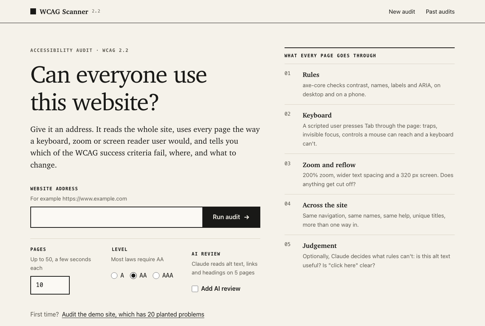
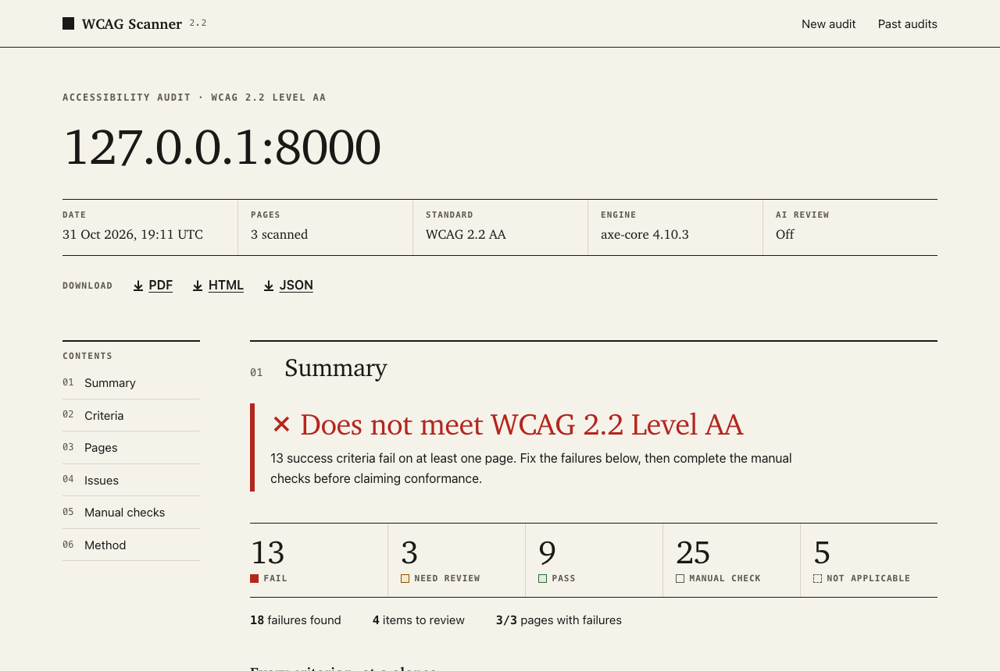
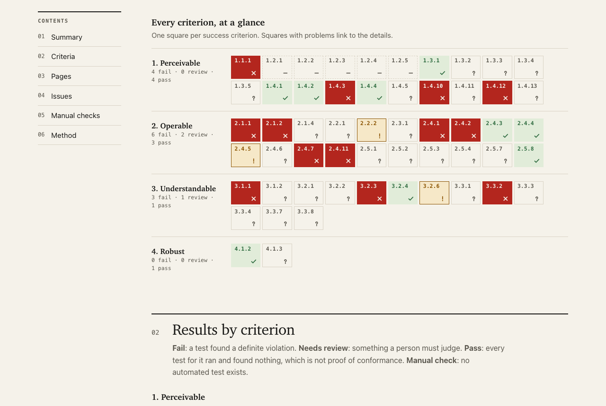
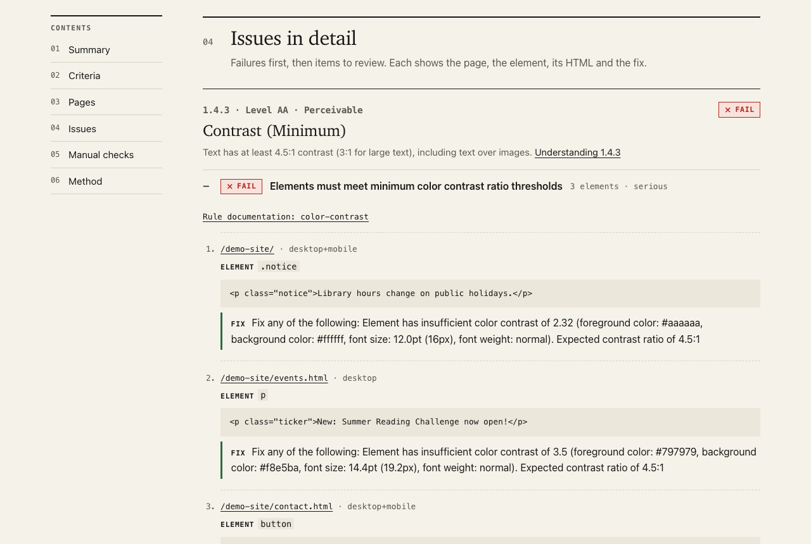

# WCAG Scanner

**An accessibility checker for whole websites.** Type in a web address. The app visits every page of the site, tests each one the way people with disabilities use the web, and produces a report showing exactly what fails, on which page, and how to fix it.



## What problem does this solve?

Over a billion people live with a disability. Many of them use the web with a keyboard instead of a mouse, a screen reader that reads the page aloud, or zoomed-in text. A website that hasn't been built with them in mind can be impossible to use: a button that can't be reached with the keyboard, an image with no description, text too faint to read.

**WCAG 2.2** (the Web Content Accessibility Guidelines, from the W3C) is the international standard for accessible websites, and the basis of laws such as the ADA in the US, the European Accessibility Act and the UK Equality Act. It has 86 rules called *success criteria* at three levels. **Level AA**, 55 criteria, is what most laws require.

Checking 55 criteria by hand on every page of a website takes days. This tool does the automatable part in minutes and tells you exactly what's left for a person to check.

## What the report tells you

Every one of the 55 criteria gets one result:

| Result | Meaning |
|---|---|
| **Fail** | A test found a definite problem, with the page, the element and a suggested fix |
| **Needs review** | A test found something suspicious that a person should judge |
| **Pass** | Every automated test for this criterion ran and found nothing |
| **Manual check** | No software can reliably test this (for example "are the video captions accurate?"), so it's listed for a person to check |
| **Not applicable** | The site doesn't have the content it covers (for example no video at all) |

The tool never claims a site is "compliant": automated testing finds roughly a third to a half of accessibility problems, and the report is honest about that. A site that couldn't be loaded (a typo, a login wall, bot protection) is reported as *could not be scanned*, never as a pass.



Every criterion at a glance. Each square is one WCAG criterion; red ones link to the details:



Each problem shows the page, the exact element, its HTML, and how to fix it:



Reports can be downloaded as **PDF**, **HTML** or **JSON**.

## Run it yourself

It takes about 5 minutes. Choose **one** of the two options.

### Option A: Docker (simplest, nothing else to install)

Needs [Docker Desktop](https://www.docker.com/products/docker-desktop/). In a terminal:

```bash
git clone https://github.com/Yashvi1713/wcag-scanner.git
cd wcag-scanner
docker build -t wcag-scanner .
docker run -p 8000:8000 wcag-scanner
```

Then open **http://localhost:8000** in your browser. The first build downloads a browser and takes a few minutes.

### Option B: Python and Node.js

Needs **Python 3.11 or newer** ([python.org/downloads](https://www.python.org/downloads/)) and **Node.js 20 or newer** ([nodejs.org](https://nodejs.org/)). The Python that comes with macOS is 3.9, which is too old: check with `python3 --version` and `node --version`.

**macOS / Linux**

```bash
git clone https://github.com/Yashvi1713/wcag-scanner.git
cd wcag-scanner

# The React front end
cd frontend && npm ci && npm run build && cd ..

# The Python back end, with its browser
python3 -m venv .venv
.venv/bin/pip install -e ".[dev]"
.venv/bin/playwright install chromium
.venv/bin/python -m wcag_scanner serve
```

**Windows (PowerShell)**

```powershell
git clone https://github.com/Yashvi1713/wcag-scanner.git
cd wcag-scanner

cd frontend; npm ci; npm run build; cd ..

py -3.12 -m venv .venv
.venv\Scripts\pip install -e ".[dev]"
.venv\Scripts\playwright install chromium
.venv\Scripts\python -m wcag_scanner serve
```

Then open **http://127.0.0.1:8000** in your browser.

### Try it

1. Click **"Audit the demo site"**. It scans a small made-up library website that ships with this project, with 20 accessibility problems deliberately planted in it (each one is marked `PLANTED` in `demo_site/`). It takes about 15 seconds.
2. Read the report: the verdict at the top, the grid of all 55 criteria, then the issues with their fixes.
3. Try a real website: type an address such as `https://www.gov.uk` (a famously accessible site) and compare it with any other site you like.

**Optional AI review.** If you have an [Anthropic API key](https://console.anthropic.com/), start the app with it set (`export ANTHROPIC_API_KEY=...` on macOS/Linux, `$env:ANTHROPIC_API_KEY="..."` on Windows) and tick **"Add AI review"**. Claude then also judges things rules can't, such as whether an image's description actually describes it, or whether a link that says "click here" is clear. Everything else works without a key.

**From the command line** (no browser window needed):

```bash
.venv/bin/python -m wcag_scanner scan https://www.gov.uk --pages 5 --pdf report.pdf
```

**Run the tests** (about 210 automated tests: Python in about a minute, React in a few seconds):

```bash
.venv/bin/python -m pytest
cd frontend && npm test
```

### If something goes wrong

| Problem | Fix |
|---|---|
| `File "setup.py" or "setup.cfg" not found`, or `requires a different Python` | Your Python is older than 3.11 (macOS ships 3.9). Install a newer one, delete the `.venv` folder and run the steps again with the new Python (for example `python3.12 -m venv .venv`). |
| `Executable doesn't exist ... chromium` | Run the `playwright install chromium` step. |
| The page says "The app isn't built yet" | Run `npm ci && npm run build` in the `frontend` folder, then reload. |
| `npm: command not found` | Install Node.js 20 or newer from [nodejs.org](https://nodejs.org/). |
| `Address already in use` | Something else uses port 8000: add `--port 8001` to the `serve` command and open that port. |
| A site says "Blocked by bot protection" | Some sites refuse automated browsers. That's reported honestly rather than guessed at. |

## For technical reviewers

### Technology

| Part | Built with |
|---|---|
| Front end | **React 19** and **TypeScript** (strict), built with **Vite**. **React Router** for pages, **TanStack Query** for data fetching and progress polling. Hand-written CSS with no UI framework, light and dark themes. |
| Back end | **Python** with **FastAPI**: a typed JSON API (interactive docs at `/docs` on a running server), and the downloadable reports |
| Scanning | **Playwright** driving headless **Chromium**, the **axe-core** rules engine, and custom in-page checks in JavaScript |
| AI review | **Claude** (Anthropic API), structured output |
| Storage | **SQLite** |
| Quality | pytest, Hypothesis, ruff, mypy · Vitest, React Testing Library, axe-core, ESLint (with jsx-a11y), Prettier |

```
 Browser                          Server (one process)
┌──────────────────────┐         ┌─────────────────────────────────────────────────────┐
│ React app            │  JSON   │ FastAPI  /api/...  ─► scanner (Playwright + Chromium)│
│  Home ─ Progress ─   │ ◄─────► │                     ─► SQLite (scan history)         │
│  Report              │         │          /scans/{id}/report.pdf|html|json (documents)│
└──────────────────────┘         │          serves the built React app                  │
                                 └─────────────────────────────────────────────────────┘
```

### How it works: five layers

Each layer catches problems the others can't.

| Layer | What it does | Code |
|---|---|---|
| 1. Automated rules | [axe-core](https://github.com/dequelabs/axe-core) 4.10 in real Chromium at desktop (1280px) and phone (375px) widths. axe's "incomplete" results become *Needs review* instead of being discarded. | `axe_runner.py` |
| 2. Interaction tests | Acts like a keyboard user: presses Tab through the page to find traps, missing or hidden focus, focus covered by sticky bars and mouse-only controls. Then 200% zoom, WCAG text spacing, 320px reflow, autoplaying sound, endless motion and placeholder-only labels. | `interaction.py`, `static/probe.js` |
| 3. Cross-page tests | Unique titles, navigation in a consistent order, consistent names for the same links, consistent help, more than one way to find pages. | `sitewide.py` |
| 4. AI review (optional) | Claude judges what rules can't: *is this alt text meaningful? is "click here" clear? is this an image of text?* Structured output, with a confidence level on every finding. | `ai_review.py` |
| 5. Report | All 55 Level A + AA criteria (or 86 with AAA): verdict, a map of every criterion, a page × principle matrix, issues with element, HTML and fix, annotated screenshots and a manual checklist. In the React app, and as HTML, PDF and JSON downloads. | `aggregator.py`, `api.py`, `frontend/src/report/`, `report.py` |

```
URL ─► address check (no private networks) ─► robots.txt + sitemap ─► crawl frontier
        │
        ├─► each page, 3 at a time, each within a time budget:
        │     load ─► axe desktop ─► dismiss cookie banner ─► media ─► forms ─► keyboard walk
        │           ─► text spacing / 200% zoom / 320px reflow ─► axe phone ─► AI (optional) ─► screenshot
        │
        └─► cross-page checks ─► one result per criterion ─► report (web / HTML / PDF / JSON)
```

### Engineering

#### Reliability: one bad page never sinks a scan
- **Time budgets.** Each page has 120s for every check (a page with a runaway script is recorded as "gave up", and the scan moves on). The whole scan stops starting new pages after 15 minutes.
- **Self-healing browser pool.** If Chromium crashes, it is relaunched and its contexts recreated, up to 3 times. Workers waiting on the pool at the moment of the crash are served by the new browser instead of hanging (there's a regression test for exactly that deadlock).
- **Optional layers can't destroy core results.** An AI or screenshot failure becomes a note on the page; the axe, keyboard and layout findings stand.
- **Honest failure reasons.** 404, login required (401), bot protection (Cloudflare/Akamai/WAF headers or a challenge page), non-HTML content, server errors and unknown hosts each get a plain-language reason in the report.
- **Restart-safe.** Scans that were running when the server stopped are marked failed on startup instead of spinning forever.

#### Security: the web app scans URLs strangers type
- **SSRF protection** (`netguard.py`). Every host is resolved and every address must be public: loopback, RFC 1918, link-local (including the cloud metadata service at 169.254.169.254), carrier-grade NAT, multicast and IPv4-mapped IPv6 are refused. Redirects are checked after each navigation, and the robots/sitemap HTTP client checks every hop. The built-in demo is the one local address allowed.
- Residual risk, stated plainly: DNS rebinding between the check and the browser's own lookup, and sub-resources (images, scripts) a page loads from private addresses. Deploy in a network without access to internal services for defence in depth.
- Security headers (`nosniff`, `DENY` framing, `no-referrer`, a restrictive permissions policy), validated scan IDs, a cap on concurrent scans (HTTP 429 beyond it), and a container that runs the browser as an unprivileged user.

#### Performance, measured
Every page records how long each stage took (`timings` in the JSON export), so tuning is based on data:

| Site | Seconds per page | Biggest stage |
|---|---|---|
| GOV.UK | 3.3 | page load 1.1s |
| Python.org | 3.9 | page load 1.6s |
| Allbirds (heavy shop) | 18 | page load 6.1s (was 8.6s before load-event settling) |

- Page settling waits for the load event and then a short network-idle grace, because sites with endless analytics traffic never go idle.
- The progress page polls a status query that never reads the multi-MB result; SQLite runs in WAL mode so readers don't block the scan that is writing.
- Screenshots are taken only for pages with findings. Finished PDFs are cached (0.5s to 2ms for a repeat download).
- The crawler strips tracking parameters (`utm_*`, `fbclid`, ...), orders query strings and scans at most 3 variants of one path, so `/search?q=...` can't eat the page budget.
- The same broken header on 50 pages is reported as **one element on 50 pages**, not 50 issues.

#### Accessibility of the app itself
A single-page app has to do what a browser normally does on page loads, so the React app:
- moves focus to the new page's heading after every navigation and updates the tab title, so screen reader users hear where they are
- announces scan progress through a polite live region, and moves focus to the report when a scan finishes while someone is watching
- links each form error to its field (`aria-invalid`, `aria-describedby`), announces it, and puts focus on the field to fix
- uses real buttons, links, tables and `<details>`, a skip link, labelled landmarks, and keyboard-reachable scroll areas

Every screen is checked three ways: axe-core in the React unit tests, ESLint's jsx-a11y rules, and **the scanner itself, run against the live app in a browser, which must find nothing at all**.

#### Code quality

```bash
.venv/bin/ruff check . && .venv/bin/ruff format --check . && .venv/bin/mypy   # Python: lint, format, types
cd frontend && npm run check                                                   # React: types, lint, format, tests
```

Python branch coverage must stay at 90% or more (currently 95%). TypeScript runs in strict mode with unchecked index access and exact optional types.

### Command line

```bash
python -m wcag_scanner scan URL [--pages 10] [--level A|AA|AAA] [--ai] [--concurrency 3] [--max-minutes 15]
                                [--fail-on fail|review|never] [--out report.html] [--json r.json] [--pdf r.pdf]
python -m wcag_scanner serve [--host 127.0.0.1] [--port 8000]
```

Exit codes let `scan` gate a deployment pipeline: **0** nothing at or above `--fail-on`, **1** issues found, **2** the site couldn't be scanned.

### Configuration

| Environment variable | Default | Purpose |
|---|---|---|
| `ANTHROPIC_API_KEY` | (unset) | Enables the AI review layer |
| `WCAG_SCANNER_DB` | `data/scans.db` | SQLite file for scan history |
| `WCAG_SCANNER_MAX_PAGES` | 50 | Largest scan the API accepts |
| `WCAG_SCANNER_MAX_ACTIVE` | 10 | Queued + running scans before the app answers 429 |
| `WCAG_SCANNER_PARALLEL` | 2 | Scans that drive browsers at the same time |
| `WCAG_SCANNER_ALLOW_PRIVATE` | off | Let the web app scan private addresses (intranet deployments only) |
| `WCAG_SCANNER_FRONTEND` | `frontend/dist` | Where the built React app is |

**Developing the front end:** run `python -m wcag_scanner serve` in one terminal and `npm run dev` in `frontend/` in another. Vite serves the app with instant reload on http://localhost:5173 and forwards API calls to the Python server.

### Tests

```bash
.venv/bin/python -m pytest                  # Python: about 190 tests, about 1 minute
.venv/bin/python -m pytest -m "not browser"  # the fast suite: about 160 tests in under a second
.venv/bin/python -m pytest --cov            # with branch coverage
cd frontend && npm test                     # React: 24 tests in a few seconds
```

| Suite | What it proves |
|---|---|
| `test_scan.py` | All 16 failures planted in `demo_site/` are found; a clean page has zero failures; **every screen of the live React app, and the downloadable report, pass the scanner with nothing to review** |
| `test_patterns.py` | Autoplaying sound fails, moving video needs review, an Escape-closable modal is a loop not a trap, fade-in focus and iframes aren't false positives |
| `test_resilience.py` | 404s, logins, bot walls, non-HTML, server errors, a runaway script, blocked redirects, an unknown host, and Chromium crashing mid-scan |
| `test_netguard.py` | Every private address range, DNS that resolves inward, redirect hops in HTTP clients, per-scan DNS caching |
| `test_crawler.py` | URL canonicalisation (including property-based tests with Hypothesis), scope, robots.txt, sitemap indexes, crawl traps |
| `test_aggregator.py` | Verdict rules, "never pass what wasn't scanned", one result per criterion at A/AA/AAA, cross-page grouping |
| `test_web.py`, `test_cli.py`, `test_storage.py` | The API and every validation path, downloads, serving the React app, exit codes, migrations, WAL, crash recovery |
| `test_contract.py` | The report the API produces matches the fixture the React tests render, so the two sides can't drift apart |
| `test_ai_review.py` | Every API failure mode degrades to a note; real page inputs reach the model and findings map back to elements |
| `frontend/src/test/` | The form (options sent, errors announced and focused, server unreachable, demo button), progress, every scan outcome, the report (criteria map, cross-page grouping, unscanned pages, screenshots, downloads), focus and titles on navigation, and axe-core on every screen |

Validated on real sites: GOV.UK and the W3C WAI site score zero failures. The W3C's [inaccessible "before" demo](https://www.w3.org/WAI/demos/bad/before/home.html) fails 7 criteria, and its [fixed "after" version](https://www.w3.org/WAI/demos/bad/after/home.html) fails only the WCAG 2.1/2.2 additions it predates. Scans of BBC, Python.org, Craigslist, a Shopify store and an accessibility company's site were checked by hand, and each false positive found was fixed with a regression test.

### Project layout

```
frontend/          the React app
  src/pages/       home page, scan page (progress, then report)
  src/report/      the report's sections
  src/components/  layout (focus and title handling), icons and status badges
  src/api.ts       typed API client and data hooks      src/types.ts   the API's shapes
  src/test/        Vitest + React Testing Library tests
wcag_scanner/
  api.py           the JSON API and the report view model
  web.py           FastAPI app: API, downloads, serves the React app
  criteria.py      all 86 WCAG 2.2 success criteria, and what a person should check for each
  netguard.py      SSRF protection
  crawler.py       which pages to scan
  scanner.py       browser pool, time budgets, runs every layer on every page
  axe_runner.py    layer 1
  interaction.py   layer 2 (Python side)    static/probe.js  layer 2 (in the page)
  sitewide.py      layer 3                  ai_review.py     layer 4
  aggregator.py    layer 5: a verdict per criterion and per page
  report.py        HTML / PDF downloads     templates/       the downloadable report and the shared stylesheet
  storage.py       SQLite scan history      settings.py      configuration
demo_site/         a fake library website with planted failures, each commented "PLANTED"
docs/              screenshots used in this README
tests/             unit, integration and browser tests; fixtures/ holds the test pages
```

### Design decisions

- **axe-core instead of home-made rules.** It's the industry standard (inside Lighthouse and Accessibility Insights) and is tagged with WCAG criteria. The value added here is everything axe can't do: keyboard, zoom, reflow, cross-page and AI judgement, plus mapping all of it onto every criterion.
- **A real browser, not downloaded HTML.** Contrast, focus, zoom and reflow only exist on a rendered page, and most sites render with JavaScript.
- **Uncertain means "Needs review", never "Fail".** A tool that cries wolf gets ignored, so every custom check was tuned against real sites.
- **React for the app, server-rendered documents for the downloads.** The app is interactive (forms, live progress, navigating a long report), so it's React. A downloaded report must work offline, years later, and print to PDF, so it's a self-contained HTML document rendered by the server. Both share one stylesheet, so they look the same.
- **The report is computed on the server.** The API sends a ready-to-render view (`ReportView`), so the verdict logic exists once, in Python, and the React code only presents it.
- **SQLite.** Zero setup, one file, plenty for a single-node service. The storage module is small enough to swap for Postgres and a job queue when scaling out.

### Limitations

- Automated testing finds roughly a third to a half of accessibility issues. "Pass" means nothing was detected, not that the criterion is met.
- Pages behind a login, and states that need interaction (open menus, dialogs, form errors), aren't tested.
- The keyboard walk stops after 80 tab stops per page. The AI layer reviews up to 5 pages per scan to limit cost, and its findings should be confirmed by a person.
- Scans run in the web process. Scaling beyond one machine would move them to a job queue with separate workers.
